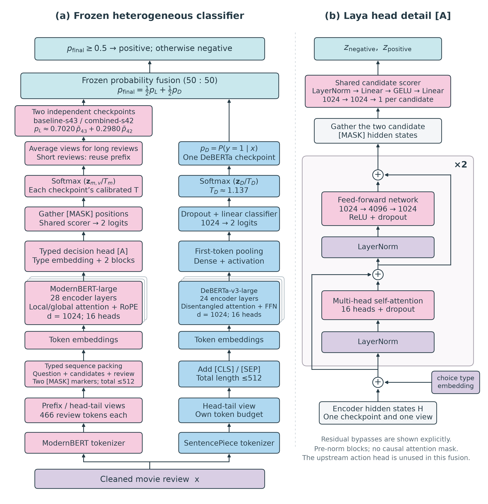

# Laya IMDB

基于 **Laya（ModernBERT-large）与 DeBERTa-v3-large** 的 IMDB 英文影评情感分类项目，提供微调代码、多视图概率融合、受控实验、跨后端核验和完整课程报告。

[项目报告](paper/README.md) · [使用与复现](docs/README.md) · [实验结果](docs/experiments/current-status.md) · [交付说明](docs/closeout/delivery.md)

## 项目概览

- **异构融合**：两个 Laya 微调模型组成多视图分支，与 DeBERTa 分支进行温度校准后的概率平均。
- **完整评估**：固定方案在 25,000 条官方测试上的 Accuracy 为 **97.028%**，Macro-F1 为 **0.970280**。
- **实验对照**：覆盖预热、标签平滑、R-Drop、重采样、鲁棒损失、长上下文、标签修订与决策头，并保留负结果。
- **多平台实现**：PyTorch 训练与评估、Apple Silicon 上的 MLX 推理，以及 CUDA／MLX 数值一致性检查。
- **配套材料**：Word、PDF、XeLaTeX 源码、11 幅图，以及三组完整重训和融合稳健性分析。

## 方法



Laya 分支使用 `baseline-s43` 与 `combined-s42` 两份微调权重。对超过 466 个评论 token 的输入，各模型平均前缀和首尾视图的校准概率；较短输入复用前缀结果。双 Laya 的内部权重由 400 条校准样本确定，约为 **70.2033% / 29.7967%**。

最终系统包含 **三个 checkpoint**，将上述 Laya 分支与 DeBERTa 的校准正类概率按 **50:50** 平均，以 0.5 为分类阈值。温度、内部权重和外层比例在该轮测试前冻结。结构、输入模板和训练参数见 [项目报告](paper/README.md)。

## 实验结果

### 固定方案：完整官方测试集

| 方法 | 正确数 / 25,000 | Accuracy | Macro-F1 | NLL ↓ | ECE ↓ |
| --- | ---: | ---: | ---: | ---: | ---: |
| 双 Laya 多视图融合 | 24,086 | 96.344% | 0.963440 | 0.114159 | 1.204% |
| DeBERTa-v3-large | 24,233 | 96.932% | 0.969319 | 0.095947 | 1.363% |
| **Laya + DeBERTa** | **24,257** | **97.028%** | **0.970280** | **0.092618** | **0.650%** |

来源：[冻结测试报告](reports/deberta-laya-final-cpu-evaluation-20261018-v1/REPORT.md)。本次 DeBERTa 使用 CPU FP32，Laya 使用已冻结的 CUDA FP32 概率缓存。融合相对双 Laya 净增 171 条正确；相对 DeBERTa 净增 24 条，精确 McNemar p=0.1568。

### 三组完整重训：同一开发集

| 方法 | 第一组 | 第二组 | 第三组 | 平均 Accuracy | 平均 ECE ↓ |
| --- | ---: | ---: | ---: | ---: | ---: |
| DeBERTa-v3-large | 97.00% | 97.28% | 96.96% | 97.08% | 1.328% |
| Laya + DeBERTa | 97.08% | 97.36% | 96.80% | 97.08% | 0.741% |

九次训练组成三套完整系统，每组均评估相同的 2,500 条开发记录。结果显示部分组合有小幅分类增益，平均 Accuracy 持平，三组 ECE 均改善。详见 [重训报告](reports/paper-gpu-supplement-20261019-v1/REPORT.md) 与 [权重稳健性分析](reports/paper-fusion-robustness-20261020-v1/REPORT.md)。

原固定方案开发 Accuracy 为 **97.28%**。研究中另有 **97.40%** 的开发探索结果，未进行对应正式测试。开发、校准和官方测试均有历史使用；数据存在重复文本，补实验也复用了开发集，结果的适用范围见 [评估限制](docs/experiments/current-status.md)。

## 快速开始

### 安装

使用 **Python 3.12** 和 **uv**。以下命令均在仓库根目录运行。

```bash
git clone https://github.com/lliooly/laya-imdb.git
cd laya-imdb

# Apple Silicon：Laya 训练和 MLX 推理
uv sync --locked --extra laya --extra laya-mlx
```

首次安装需要联网。Linux CUDA、DeBERTa 和统计分析使用各自的锁定环境，见 [环境说明](environments/README.md)。数据和微调权重需单独准备，Git 仓库不包含这些文件。

### 本地单条预测

在 Apple Silicon 上恢复 `checkpoints/laya-l512-s42-ce/` 的完整微调模型后：

```bash
uv run --locked --offline --no-sync python scripts/predict.py \
  'The acting was excellent, and I loved the ending.'
```

输出 JSON 包含 `label`（`negative` / `positive`）、校准概率、原始概率、输入长度与截断信息。可通过 `--checkpoint` 指定同结构本地权重，通过 `--dtype float32` 切换精度。

**此命令运行历史 Laya 单模型**（开发 Accuracy 95.76%），用于本地预测演示。97.028% 对应上文三模型冻结评估；仓库内尚无统一的异构融合单条 CLI；随附模型包的 `predict_final.py` 已完成 CPU 单条输入与哈希核验，使用说明随模型包提供。双 Laya 的现有推理入口及 CUDA／MLX 核验方法见 [推理指南](docs/guides/inference.md)。

### 训练与复现

```bash
# 校验训练配置，不加载数据、模型或加速器，不启动训练
uv run --locked --offline --no-sync python scripts/train_laya.py \
  --config configs/laya-full-ce.json --validate-config

# 查看预测参数
uv run --locked --offline --no-sync python scripts/predict.py --help
```

数据准备、模型来源、训练配置、历史结果所需资产和检查命令见 [复现指南](docs/closeout/reproduction.md)。已有实验目录受到覆盖保护；复跑需新建 `run_id` 并核对相应协议。

## 项目结构

```text
.
├── scripts/          # 数据、训练、推理、评估与实验分析
├── tests/            # 单元测试与科学边界检查
├── configs/          # 实验配置、模型版本与文件哈希
├── environments/     # 各平台和任务的独立依赖锁
├── paper/            # 最终 Word / PDF 报告、TeX、图表与核验记录
├── docs/             # 使用指南、研究台账与历史设计
├── reports/          # 按实验保存的结果和验证证据
├── archive/          # 停用实现
└── rust-tokenizer/   # 历史分词工程
```

`data/`、`checkpoints/`、`artifacts/` 和 `delivery/` 为本地资产目录，不进入 Git。

## 文档与交付

| 内容 | 入口 |
| --- | --- |
| 课程报告与编译方法 | [paper/README.md](paper/README.md) |
| 环境、数据和复现 | [复现指南](docs/closeout/reproduction.md) |
| 单条预测与多模型推理 | [推理指南](docs/guides/inference.md) |
| 最终结果与研究限制 | [当前状态](docs/experiments/current-status.md) |
| 历史实验设计与证据 | [研究台账](docs/closeout/research-ledger.md) |
| 测试方法 | [tests/README.md](tests/README.md) |
| 交付材料与待验收项 | [交付说明](docs/closeout/delivery.md) |

最终报告已经包含补实验、权重诊断、跨后端核验与推理成本分析。源码与报告材料包各自提供文件清单和 SHA256；权重、原始数据和视频单独交付。

## 致谢与许可

本项目基于 [Laya](https://github.com/NandhaKishorM/laya)、[ModernBERT](https://github.com/AnswerDotAI/ModernBERT)、[DeBERTa](https://github.com/microsoft/DeBERTa) 与 [MLX](https://github.com/ml-explore/mlx)，使用 [Stanford IMDB 数据集](https://ai.stanford.edu/~amaas/data/sentiment/)。更多文献见 [参考资料](docs/closeout/references.md)。

原创代码采用 [MIT License](LICENSE)。第三方代码、模型和数据遵循各自条款，详见 [第三方声明](THIRD_PARTY_NOTICES.md) 与 [Apache-2.0 许可证文本](docs/THIRD_PARTY_APACHE_LICENSE.txt)。
