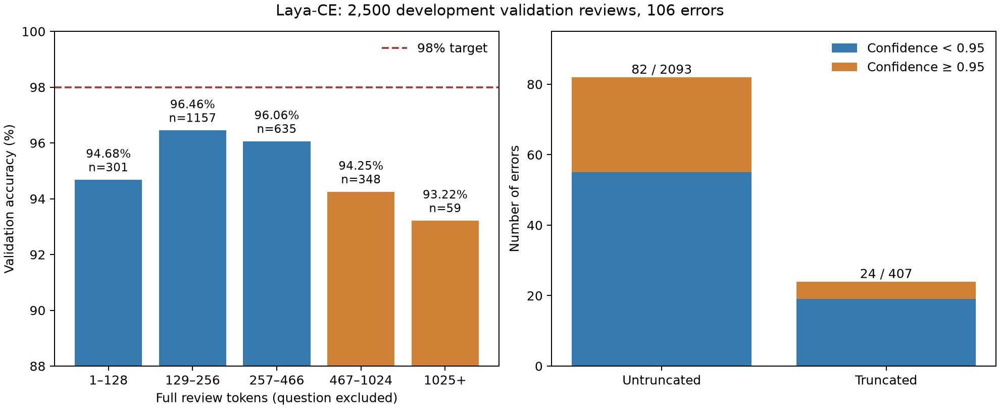

# Laya-CE 验证错误分析

日期：2026-10-10。使用已保存的完整开发验证预测，在 CPU 上分析，未重新推理或训练，未访问官方测试集。

## 主要发现

现有模型正确 2,394/2,500 条，Accuracy 为 95.76%，错误 106 条。达到开发验证 98% 需要错误不超过 50 条，即净减少至少 56 条；新增错误也必须计入。

| 分组 | 评论数 | 错误数 | Accuracy | 原生校准置信度 ≥0.95 的错误 |
|---|---:|---:|---:|---:|
| 全部 | 2,500 | 106 | 95.76% | 32 |
| 未截断 | 2,093 | 82 | 96.08% | 27 |
| 截断 | 407 | 24 | 94.10% | 5 |

问题与选项占用 45 token，512 总预算实际保留最多 466 个影评 token，加上末尾分隔符。真实截断比例为 16.28%；错误中 22.64% 发生截断。不能把 ModernBERT 的 >256 或 >512 分层当作 Laya 的实际截断定义。

即使纠正全部 24 条当前截断错误且其他预测不变，也只有 96.72%。这只是固定错误集合上的理想化算术情景，不是性能预测，也不限制新训练方法对其他样本的影响。它说明冲刺 98% 不能仅寄希望于补齐当前截断样本。



按完整影评 token 分层，1–128、129–256、257–466、467–1024、1025+ 的 Accuracy 分别为 94.68%、96.46%、96.06%、94.25%、93.22%。最长组只有 59 条。长度、内容难度和标签构成同时变化，这些是描述性结果，不能证明截断的因果影响。

Laya 的 106 条错误中，69 条也是 ModernBERT 的错误，37 条 ModernBERT 正确。两模型训练与输入条件不同，此交集只提示可继续研究互补性；它不代表某个可实现集成能够自动纠正所有互补错误。

## 定性抽查与限制

对 16 条有代表性的错误进行定性阅读，记录在 `qualitative_spot_checks.json`。这是 Codex 的初步阅读，未经过独立人工复核，且为有目的选例；不据此统计 106 条错误的语义类别比例。

- 混合评价与 camp 欣赏：`train/pos/11192_10.txt`、`train/pos/11727_7.txt` 对拍摄或艺术质量有批评，但仍明确表达观影乐趣。
- 评价对象和否定范围：`train/pos/5506_10.txt` 反驳他人对纪录片的差评；`train/neg/10566_3.txt` 欣赏系列却批评先导电影。
- 观影情绪与作品评价：`train/pos/2435_8.txt` 描述悲伤、压抑的观影体验，同时承认作品经典。
- 可能的反讽：`train/neg/11233_2.txt` 用“只值很少的钱”表达低价值判断；具体机制仍需复核。
- 尾部信息遗漏：`train/pos/12230_9.txt` 被丢弃的后文明确表达观影乐趣；`train/neg/2291_4.txt` 被丢弃的后文批评影片回避核心故事。尚未执行替换输入的反事实实验，不能声称首尾保留已纠正它们。
- 标签与文字的张力：`train/pos/1230_10.txt`、`train/pos/3160_7.txt`、`train/neg/3155_1.txt` 的词面评价与原标签存在张力。仅记录疑点，不修改标签，不删除样本，也不将疑似标签问题归为已经确认的数据错误。

这些线索支持研究整体评价理解和长文本信息利用，但不能证明某个学习率、轮数、正则化或结构改动必然有效。禁止针对这些验证 ID 编写纠错规则。

## 优先实验方向

1. 先验证 CUDA 的训练、保存重载与 Mac 推理闭环，建立新平台 CE 参照；框架、精度变化单独记录。
2. 在同一数据 ID、校准集与输入策略下有限筛选训练轮数和学习率；需要 warmup 时先扩展并验证训练器。现有上游训练器未提供 warmup 配置字段，不能直接将计划中的参数传入。
3. 对照相同 512 总 token 预算下的前缀与首尾保留。训练、校准、验证和部署必须采用一致策略，不能只改验证输入就宣称训练方法有效。
4. 选有完整验证证据的改动做消融，再冻结方法用于迁移。当前没有新准确率结果，也不能保证达到 98%。

## 复现与产物

在仓库根目录运行，输出目录已存在时拒绝覆盖；复现使用新的 `--out`：

```bash
uv run --offline --locked --extra laya python scripts/analyze_laya_errors.py \
  --out reports/laya-ce-error-analysis-reproduction
uv run --offline --locked --extra laya --extra analysis python scripts/plot_laya_errors.py \
  --report reports/laya-ce-error-analysis-reproduction
```

- `summary.json`：完整统计、原生温度和数据/预测/权重/源码哈希。
- `error_index.csv`：全部 106 条错误的 ID、标签、长度、置信度与基线是否正确，不包含全文。
- `data/errors.jsonl`：包含全部错误全文及被丢弃后文的本地复核队列；由 `.gitignore` 排除，不纳入源码提交。
- `qualitative_spot_checks.json`：本次 16 条抽查笔记；重跑脚本不自动复制或生成语义判断。
- `error_strata.png`、`plot_manifest.json`：静态图表和生成记录。

校验包括冻结验证哈希/ID、原始预测哈希、checkpoint 哈希、tokenizer 语义配置和逐条输入重建，并与历史保存预测重新核对 106 条错误。保存 tokenizer 的 JSON 保留了选项处理阶段的临时 48-token 截断设置；分析先排除该运行设置再计算完整长度，同时逐条核对训练时的实际输入序列。

置信度使用 checkpoint 的原生温度 1.4808366；未采用历史模型比较中由开发验证子集拟合的分析温度。高置信度错误数 32/106 使用同一原生口径。
