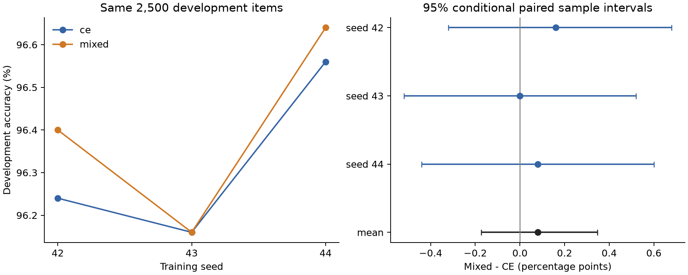

# Laya 鲁棒损失三种子配对实验完整分析

报告生成：2026-10-16T16:00:14+08:00。科学协议：`laya-robust-loss-modal-deferred-20261015-v2`。这是固定配置的探索性开发实验，未使用官方测试。

## 1. 结论与当前决策

**固定的 0.5 CE + 0.5 GCE(q=0.7) 未达到预先约定的继续投入门槛。** CE 的三种子平均 Accuracy 为 96.32%，mixed 为 96.40%，平均差 **+0.08 pp**，相当于每份 2,500 条开发集平均净多答对 2 条。三个配对差为 +0.16、0.00、+0.08 pp；10,000 次共同 ID、标签分层配对 bootstrap 的均值差 95% 条件样本区间为 **[-0.174, +0.347] pp**。

点估计温和偏正，但区间包含 0，也包含 +0.20 pp。现有证据允许小幅正负效应，不能作等效或普遍无效结论。当前配置不升级为默认配方，不自动增加种子、混合比例或 q 值搜索，不据此启动新训练。原 +0.20 pp 均值门槛未通过；至少 2 / 3 为正、任一种子下降不超过 0.20 pp 两项通过。该门槛只是是否值得确认实验的参考，不等于显著性或部署批准。

截断组 407 条的均值差为 **−0.3276 pp**，三个种子均为负；未截断组 2,093 条为 **+0.1593 pp**。两组条件区间均跨 0，不能据此宣称组间交互显著，但必须保留这项风险，不能只展示全体均值。

训练 6 / 6、最终模型本地严格交付 6 / 6、开发评估本地严格交付 6 / 6、配对分析均已完成。**完整逐轮备份尚在接收：epoch-001 模型及 AdamW / RNG 恢复包本地为 1 / 6（报告生成时）。** 六份最终模型不再依赖云端可用性；未完成的逐轮包仍有原 Volume 备份，不能将本报告称为所有恢复包交付完成。

## 2. 协议与验收证据

- 原始两层头；发布版 Laya 编码器加重新初始化的头，CE / mixed 同 seed 起始权重 SHA 相同。固定 seed42 / 43 / 44，训练顺序分别为 CE→mixed、mixed→CE、CE→mixed。
- 同一 22,100 条梯度训练、400 条校准和 2,500 条开发划分。输入为首尾 512 总 token、466 评论预算。保留原选项置换，未改标、删除或定向重采样 94 条训练诊断候选。
- 每模型 2 epochs、micro-batch 8、5,526 次接受更新和 44,200 次暴露。合计 33,156 次接受更新、265,200 次暴露；不把被抢占后丢弃、重新计算的更新计入这一科学轨迹总数，成本记录另行包含重算开销。
- L40S、锁定 PyTorch 2.14.1+cu126 / Laya 0.4.1、CUDA FP32、AMP / TF32 关闭、strict 数值设置。六份更新日志编号连续且数值有限；三对输入流、初始化、划分和逐更新学习率相同。
- 固定 epoch-002，不按开发集选 epoch、seed 或损失参数。六模型共同冻结后才启动开发评估，冻结文件与六份请求 SHA 一致；400 条参考预测和独立 CUDA 重载 logits bitwise equal，温度只用校准集拟合。
- 用户后续批准云端先持久化、唤醒后本地回传，替代初版的同步本地收据门禁。此偏离已经在 deferred-v2 中独立版本化；本轮未把云端收据伪装成本地交付。
- 原 122 项科学绑定文件 SHA 全部重新核验；旧恢复层 4 项绑定不变。分析重新验证 18 份本地最终 / 冻结 / 评估收据、文件 SHA 和冻结模型身份；2,500 条样本 ID、标签、截断标记及实际输入 SHA 六模型完全一致，开发与梯度 / 校准 ID 不交叉。NLL、ECE、Brier、Accuracy 和 AUROC 从保存 logits 独立复算，容差 1e-12。

纯统计脚本为 `scripts/analyze_laya_robust_loss.py`，其源码及统计测试 SHA 已写入 `summary.json`。新增预算测试 4 项、统计测试 3 项通过；原 Modal 传输 / 云端收据 / 故障恢复 16 项通过，合计 23 项。它们与真实模型交付及 CUDA 评估证据分别记录，不能互相替代。

## 3. Accuracy 与样本修正 / 退化

| seed | CE | mixed | mixed−CE（pp） | 修正 / 退化 | 精确 McNemar p | 条件样本 95% 区间（pp） |
| --- | --- | --- | --- | --- | --- | --- |
| 42 | 96.24% | 96.40% | +0.16 | 22 / 18 | 0.635828 | [-0.320, +0.680] |
| 43 | 96.16% | 96.16% | +0.00 | 23 / 23 | 1.000000 | [-0.520, +0.520] |
| 44 | 96.56% | 96.64% | +0.08 | 22 / 20 | 0.877614 | [-0.440, +0.600] |

修正表示 CE 错、mixed 对；退化表示 CE 对、mixed 错。每个种子按相同样本配对，名义 p 未作多重比较校正。没有将三份重复开发样本当作独立的 7,500 条做汇总检验。

配对效应的样本标准差为 0.080 pp，范围 [+0.000, +0.160] pp。留出 seed42 / 43 / 44 后，剩余两个配对均值分别为 +0.04 / +0.12 / +0.08 pp。三种子双侧 sign-flip 的本轮名义 p=0.50；只有三个种子时最小可能双侧 p 为 0.25，本轮还有一个零差，不能用它证明跨种子显著。



### 3.1 截断分组

| 分组 | 独立样本数 | CE 三种子均值 | mixed 三种子均值 | 均值差（pp） | 条件样本 95% 区间（pp） |
| --- | --- | --- | --- | --- | --- |
| 全体 | 2500 | 96.3200% | 96.4000% | +0.0800 | [-0.174, +0.347] |
| 截断 | 407 | 96.5602% | 96.2326% | -0.3276 | [-0.901, +0.246] |
| 未截断 | 2093 | 96.2733% | 96.4326% | +0.1593 | [-0.143, +0.462] |

| 分组 | seed | CE 正确数 | mixed 正确数 | 修正 / 退化 | 差（pp） | 精确 McNemar p |
| --- | --- | --- | --- | --- | --- | --- |
| 截断 | 42 | 394 | 393 | 4 / 5 | -0.2457 | 1.000000 |
| 截断 | 43 | 392 | 390 | 5 / 7 | -0.4914 | 0.774414 |
| 截断 | 44 | 393 | 392 | 2 / 3 | -0.2457 | 1.000000 |
| 未截断 | 42 | 2012 | 2017 | 18 / 13 | +0.2389 | 0.473130 |
| 未截断 | 43 | 2012 | 2014 | 18 / 16 | +0.0956 | 0.864166 |
| 未截断 | 44 | 2021 | 2024 | 20 / 17 | +0.1433 | 0.742829 |

截断组下降约相当于每个模型平均少答对 1.33 条，未截断组提升约相当于平均多答对 3.33 条。分组结果是预先要求的风险披露，尚未检验组间交互，不据此增加按长度选择损失的新策略。

### 3.2 不确定性的范围

bootstrap 固定六个已训练模型，每轮在每个标签层内共同重采样样本 ID，再计算三个配对差及其平均，重复 10,000 次，随机种子 20261015。它保持同一样本在不同模型之间的相关性；分组内也保留原标签层大小。

这些区间不包含新训练种子总体、重新拟合校准温度、训练数据抽样或历史开发集反复使用造成的选择偏差。仅三个 seed 的标准差和留一结果是描述性检查，不能把区间称作整体泛化保证。全体区间跨 0、允许 +0.20 pp；其下界略高于 −0.20 pp 也不构成双侧等效性证据。分组、概率和错误重叠是次级分析，未作全族多重比较校正。

本轮 96.32% / 96.40% 仅属于固定开发集。不会从历史约 0.6 pp 开发—测试差距机械扣分来预测新模型测试准确率；官方测试没有重新读取，不用其历史结果反选当前模型。

## 4. 概率质量与校准

| seed / arm | 校准温度 | NLL 原始 / 校准 | ECE 原始 / 校准（%） | Brier 正类原始 / 校准 |
| --- | --- | --- | --- | --- |
| 42 / ce | 1.82508 | 0.172166 / 0.118922 | 3.326 / 1.593 | 0.035160 / 0.031660 |
| 42 / mixed | 1.77880 | 0.156557 / 0.112353 | 3.216 / 1.238 | 0.033329 / 0.030082 |
| 43 / ce | 1.66670 | 0.178549 / 0.124378 | 3.347 / 2.006 | 0.034971 / 0.032445 |
| 43 / mixed | 1.84992 | 0.186861 / 0.122425 | 3.493 / 1.635 | 0.035962 / 0.032607 |
| 44 / ce | 1.62094 | 0.164899 / 0.117142 | 3.085 / 1.819 | 0.032674 / 0.030340 |
| 44 / mixed | 1.53662 | 0.161331 / 0.118171 | 3.001 / 1.978 | 0.031800 / 0.029911 |

ECE 表中以百分数表示平均校准差，Brier 使用正类概率平方误差，数值均越低越好；多类二元 Brier 为该值的两倍，完整值在 `summary.json`。每个模型的正温度只在原 400 条拟合，不改变 Accuracy。

| 分组 | 原始 NLL 差及 95% 区间 | 校准 NLL 差及 95% 区间 |
| --- | --- | --- |
| 全体 | -0.003622 [-0.015005, +0.007664] | -0.002498 [-0.009092, +0.004040] |
| 截断 | +0.021073 [-0.001603, +0.046066] | +0.011499 [-0.001183, +0.025494] |
| 未截断 | -0.008424 [-0.021069, +0.004405] | -0.005220 [-0.012568, +0.002314] |

差值方向为 mixed−CE，负值表示 mixed 的 NLL 更低。均值存在小幅改善，但全体原始和校准 NLL 的条件区间均跨 0；校准后的 NLL、ECE、Brier 也并非每个 seed 都改善。截断组 NLL 的点差为正，与该组 Accuracy 下降方向一致，但其区间同样包含 0。温度视为已固定，这些次级区间未包含校准集重采样 / 重拟合的不确定性。

## 5. 训练诊断与成本

### 5.1 同尺度的训练 CE

| seed | CE 公共 CE 第一轮 / 第二轮 | mixed 公共 CE 第一轮 / 第二轮 |
| --- | --- | --- |
| 42 | 0.201008 / 0.062109 | 0.204752 / 0.070514 |
| 43 | 0.208840 / 0.064570 | 0.205250 / 0.065881 |
| 44 | 0.201194 / 0.065064 | 0.206136 / 0.062533 |

这里是每个训练更新日志中的未平滑 CE 按更新均值聚合，与固定训练路径保持一致；含训练期 dropout 和不断变化的参数，不是固定最终模型的训练集评估。CE 与 mixed 自身的目标损失数值不直接比较。第二轮公共 CE 两个 seed 上升、一个下降，没有稳定的训练 CE 优势；这既不能单独证明标签噪声缓解，也不替代开发结果。

### 5.2 训练与存储

| seed / arm | 接受更新数 | 进程区间（秒） | 时间口径 | 峰值 allocated（GiB） | 峰值 reserved（GiB） |
| --- | --- | --- | --- | --- | --- |
| 42 / ce | 5526 | 2951.37 | 完整两轮进程 | 7.8266 | 8.4277 |
| 42 / mixed | 5526 | 1493.22 | 第二轮恢复进程 | 7.8368 | 8.4277 |
| 43 / ce | 5526 | 2978.73 | 完整两轮进程 | 7.8268 | 8.4004 |
| 43 / mixed | 5526 | 2941.31 | 完整两轮进程 | 7.8268 | 8.4004 |
| 44 / ce | 5526 | 2980.98 | 完整两轮进程 | 7.8310 | 8.3887 |
| 44 / mixed | 5526 | 2973.12 | 完整两轮进程 | 7.8310 | 8.3887 |

进程区间包括训练、保存与前一轮交付等待，不是纯 GPU kernel 时间。mixed seed42 从已核验 epoch-001 恢复，因此表中只覆盖第二轮进程，不能与完整两轮的 CE42 比较速度。仅描述两个未恢复配对 seed43 / 44 时，mixed 的平均进程区间约少 0.76%；不据此声称稳定训练加速。两臂参数均为 421,029,889，峰值 allocated 约 7.827–7.837 GiB，未显示有实用意义的显存节省。

六份最终 safetensors 合计约 9.41 GiB，全部已本地严格加载；路径为 `checkpoints/laya-robust-loss-modal-deferred-<arm>-s<seed>-strict-fp32-20261015-v2/epoch-002/`。配置、tokenizer、源码 / 环境锁、输入和更新审计、校准与冻结包随最终包保存。本地索引为 `reports/laya-robust-loss-modal-recovery-20261016-v1/local-final-model-index.json`；本地正式收据为 `delivery/receipts/<request_sha256>.json`。epoch-001 另含约 3.14 GiB 的 AdamW / RNG 状态，继续逐文件 SHA 与独立加载验证；完成数以 `local-first-epoch-delivery.json` 为准。

### 5.3 Modal 执行与预算

训练阶段曾在约 24 美元保守窗口处停止，已完成六模型训练但仅评估 CE42。用户本次要求继续后，从原确认的 30 美元赠送额度余量单独预留最多 1 美元，累计保守上限 25 美元。原历史预算记录与科学配置保留，没有删除旧开销或伪造余额。

五项补充评估在单 L40S 上串行执行，约 8.61 分钟；五项实际命令均仅为 evaluate，无新增 optimizer 更新。函数调用 `fc-01M51TVWD45B9S8TDB3J36M3ZP` 已 SUCCESS；App `ap-GulvmjvLvhJeZEMLpeoSrO` 于北京时间 15:56:06 停止，任务数为 0。首次启动前的函数序列化错误发生在提交 GPU 前，预算未预留，记录保留；修复后仅成功提交一次。

云端状态按每小时 3 美元、从提交到完成并加清理缓冲记的累计保守上界约为 24.4804 美元。共享账本保留完整 25 美元预留上界，不将其当作实际账单；CLI 无法查询 Starter 当前赠送余额。费率参照 [Modal 官方定价](https://modal.com/pricing)，账单以 Usage & Billing 为准。所有本次 App 当前均 stopped / 0 tasks，本地下载不重新启动 GPU。

完整终态、调用图、App 快照、五项命令及六模型云端评估 ACK / 收据见 `reports/laya-robust-loss-modal-evaluation-20261016-v1/`。早期恢复记录见 [恢复报告](../laya-robust-loss-modal-recovery-20261016-v1/REPORT.md)。

## 6. 错误重叠与解释边界

六个模型全部答错的开发样本为 48 条，其中截断 7 条、未截断 41 条。这是本轮六模型的描述性队列，与旧 L2 的 46 条、旧多视角 oracle 的共同错误属于不同集合，不能混算或互换。

至少一个模型答错的样本为 153 条。只保存 ID / 标签 / 截断标记等诊断记录，不把这些开发错误加入训练或用它们构造定向增广，不根据它们再搜索融合方案。本轮没有训练集折外预测或对噪声标签的因果识别；损失也改变整体梯度尺度，因此微小开发点差不能单独归因于修正标签噪声。

## 7. 下一步优先级

1. **完成逐轮恢复包本地归档。** 最终模型与全部评估已可交付，第一轮恢复包仍在本机后台接收；云端 Volume 不删除。状态、日志分别为 `local-first-epoch-delivery.json`、`local-first-epoch-download.log`，中断后校验块 SHA 再继续，不重复训练。
2. **收尾这一固定混合损失配置。** 保留源码、配对结果、截断风险与不确定性，作为论文中可复核的已有方法对照；不消耗剩余额度搜索 q / 比例或追加种子。
3. **继续低成本、独立证据的数据诊断与公平迁移协议。** 94 条训练侧候选需要独立复核 / 折外证据，当前同 seed 样本内诊断不替代这些证据。ModernBERT-base / Laya-RLCD 的后续设计以同期 CE、固定划分、输入和训练预算为基准，重新训练前核实可用预算；不以当前结果证明跨模型有效，不自动启动。

如果未来另有预算做确认实验，应先明确足够种子及独立验证数据的设计，再确认小幅效应；不能把本轮正点估计或单个 96.64% 反选为获胜方法。98% 全覆盖目标在本轮仍未达到，当前证据不支持承诺达到。

## 8. 本地复算

```bash
uv run --locked --offline --no-sync python scripts/analyze_laya_robust_loss.py \
  --output /private/tmp/laya-robust-loss-analysis-recheck-20261016-v1
```

输出目录必须不存在，脚本不会覆盖已有分析。它验证科学源码、交付清单、收据、输入和保存指标，再从六份固定 logits 复算 10,000 次配对 bootstrap；不进行模型前向、不访问云端、不读取官方测试。图表同时保存为 PNG / SVG，完整机器结果见 [summary.json](summary.json)。
