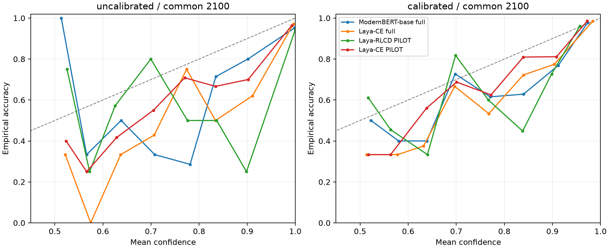
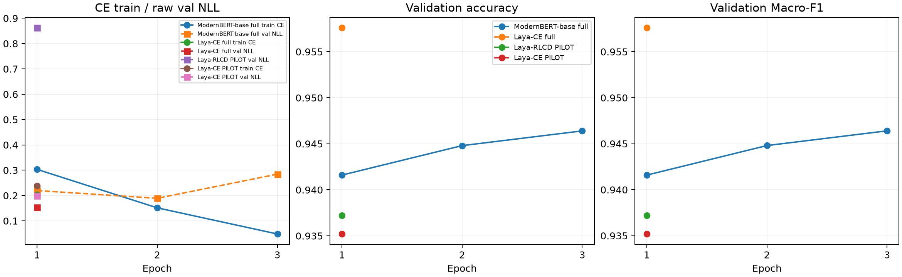
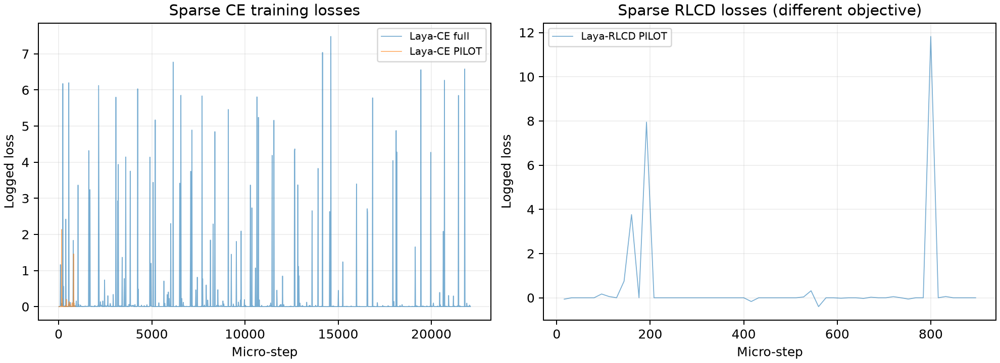

# ModernBERT 与 Laya-CE / Laya-RLCD 实验分析

本报告由冻结配置、训练日志、已保存权重的离线推理结果自动生成；未重新训练，未访问官方测试集。

## 结论与证据边界

1. **Decision Head 的独立收益尚未验证。** 缺少 ModernBERT-large + 普通分类头这一控制组；当前模型规模、输入长度、头结构、预训练及训练预算均不同。
2. **CE 与 RLCD 的干净对照是两份 pilot。** 它们模型、训练/校准样本和超参数一致，只有损失不同。完整 2,500 条上 RLCD=93.72%、CE=93.52%，仅相差 5 条；公共 2,100 条配对 McNemar p=1，未观察到准确率差异的统计证据。CE 的 AUROC、未校准 NLL/Brier 更好；统一温度校准后 CE 的 NLL/Brier 仍更低，但 RLCD 的 ECE 更低。因此不能说 CE 在所有校准指标上全面占优。全量 CE 对 pilot RLCD 是不同预算方案比较，不能当作损失函数优劣证据。
3. **额外参数是否值得还没有完整成本证据。** 已有准确率收益和参数量，缺少统一训练计时、统一推理延迟/显存测量及同骨干消融。

## 模型与训练配置

| 项目 | ModernBERT-base full | Laya-CE full | Laya-RLCD PILOT | Laya-CE PILOT |
|---|---|---|---|---|
| Pretrained checkpoint | answerdotai/ModernBERT-base | convaiinnovations/laya | convaiinnovations/laya | convaiinnovations/laya |
| 总参数 | 149015810 | 421293827 | 421293827 | 421293827 |
| 可训练参数（声明） | 149015810 | 421293827 | 421293827 | 421293827 |
| Encoder 参数 | 149014272 | 394781696 | 394781696 | 394781696 |
| Head 参数 | 1538 | 26512131 | 26512131 | 26512131 |
| 最大总长度 | 256 | 512 | 512 | 512 |
| 实际轮数 | 3 | 1 | 1 | 1 |
| 最佳轮数 | 3 | 1 | 1 | 1 |
| 设备 batch | 8 | 1 | 1 | 1 |
| 梯度累积 | 1 | 8 | 8 | 8 |
| 有效 batch | 8 | 8 | 8 | 8 |
| Encoder 初始 LR | 2e-05 | 2.5e-05 | 2.5e-05 | 2.5e-05 |
| Head 初始 LR | 2e-05 | 0.0001 | 0.0001 | 0.0001 |
| Optimizer | MLX AdamW, bias_correction=True | PyTorch AdamW; default betas=(0.9,0.999), eps=1e-8 | PyTorch AdamW; default betas=(0.9,0.999), eps=1e-8 | PyTorch AdamW; default betas=(0.9,0.999), eps=1e-8 |
| Weight decay | 0.01 | 0.01 | 0.01 | 0.01 |
| Scheduler | linear warmup then linear decay to zero | CosineAnnealingLR, eta_min=1e-6 | CosineAnnealingLR, eta_min=1e-6 | CosineAnnealingLR, eta_min=1e-6 |
| Warmup 比例 | 0.1 | 0 | 0 | 0 |
| Seed | 42 | 42 | 42 | 42 |
| Loss | CE | soft-ce | rlcd | soft-ce |
| Freeze Encoder | False | False | False | False |
| 训练精度 | float32; MLX_ENABLE_TF32=0 | float32; autocast off | float32; autocast off | float32; autocast off |
| 保存精度 | float32 | fp16; reloaded float32 for analysis | fp16; reloaded float32 for analysis | fp16; reloaded float32 for analysis |
| 梯度训练样本 | 22500 | 22100 | 896 | 896 |
| 原生校准样本 | 0 | 400 | 128 | 128 |
| 原生验证样本 | 2500 | 2500 | 256 | 256 |
| 参数更新次数 | 8439 | 2763 | 112 | 112 |
| 耗时记录（秒，口径不同） | 3663.07316617616 | 8738.100077124996 | 334.42528570799914 | 347.54805716600094 |

硬件均为 Apple M5 Pro、64 GB 统一内存，没有独立显存。ModernBERT 使用 MLX，Laya 使用 PyTorch/MPS。

实测参数量：基线 149,015,810，Laya 421,293,827，约 2.83 倍；Laya Encoder 为 394,781,696，Encoder 外为 26,512,131。相对基线的参数增量约 90% 来自升级 Encoder，而非新增 Head。Laya 当前问题模板占 45 token，实际影评预算 466；基线总长 256 还包含特殊 token。

ModernBERT 耗时是 forward/backward/update 的计时求和；Laya 是整个 finetune 流程计时，含评估、保存及进程暂停。本轮全量 CE 曾暂停，不能用 8738 秒直接计算相对训练效率。MPS 结束时内存不是峰值，Laya 峰值未记录。

Laya 总参数中的 action head 虽 requires_grad=True，但分类损失不使用该分支；其参数数量及损失关联参数另见各 manifest。2 层 Transformer Decision Head、MASK 选项打分、输入模板和原问题 schema 均保留。

## 数据、选点与校准协议

IMDB 固定划分：22,500 条训练、2,500 条开发验证、25,000 条官方测试，原始划分 seed=42。Head/prefix 截断；Laya 的问题和选项占用 512 总预算，实际影评预算见 manifest。

ModernBERT 用完整开发验证 Macro-F1 最大选 epoch 3（并列时 NLL 更低）；Laya 仅训练 1 轮，报告的是唯一最终 checkpoint，不能称其经过多轮最优选择。

统一校准分析：从开发验证集用 seed=20261009 按类抽 400 条（每类 200）拟合各模型温度，其余 2,100 条独立计算校准指标。公共校准/评估 ID 严格互斥，所有模型行对齐；温度范围 [0.05,20]。这是一套分析用的统一温度，不是覆盖模型内置温度。

由于此前选 checkpoint/做 pilot 已使用开发验证数据，以上不是全新最终测试，也不用于声称无选择偏差。原生 Laya 校准则分别只用原训练划分中留出的 400/128 条样本。



低置信度分箱可能只有少量样本，因此局部波动不能单独解释为稳定规律；每箱样本数保存在 metrics.json。

## 完整 2,500 条验证：未校准分类成绩

| 指标 | ModernBERT-base full | Laya-CE full | Laya-RLCD PILOT | Laya-CE PILOT |
|---|---|---|---|---|
| Accuracy ↑ | 0.946400 | 0.957600 | 0.937200 | 0.935200 |
| Macro-F1 ↑ | 0.946400 | 0.957600 | 0.937200 | 0.935187 |
| Precision macro ↑ | 0.946401 | 0.957611 | 0.937200 | 0.935561 |
| Recall macro ↑ | 0.946400 | 0.957600 | 0.937200 | 0.935200 |
| AUROC ↑ | 0.986612 | 0.991610 | 0.976733 | 0.983555 |
| NLL ↓ | 0.284442 | 0.152805 | 0.862236 | 0.198761 |
| Brier（双类和）↓ | 0.099491 | 0.072691 | 0.120227 | 0.104431 |
| ECE ↓ | 0.049106 | 0.032237 | 0.059146 | 0.040898 |

## 公共 2,100 条评估：统一校准前后

所有模型使用相同评估 ID；表中 RLCD 仍为 pilot，训练预算差异没有消失。

| 指标 | ModernBERT-base full | Laya-CE full | Laya-RLCD PILOT | Laya-CE PILOT |
|---|---|---|---|---|
| Accuracy ↑ | 0.946667 | 0.957619 | 0.936667 | 0.936190 |
| Macro-F1 ↑ | 0.946666 | 0.957619 | 0.936667 | 0.936177 |
| Precision macro ↑ | 0.946681 | 0.957619 | 0.936670 | 0.936547 |
| Recall macro ↑ | 0.946667 | 0.957619 | 0.936667 | 0.936190 |
| AUROC ↑ | 0.985913 | 0.991220 | 0.976351 | 0.983206 |
| NLL ↓ | 0.290591 | 0.156377 | 0.864163 | 0.196433 |
| Brier ↓ | 0.100651 | 0.073742 | 0.121814 | 0.102154 |
| ECE ↓ | 0.049204 | 0.032649 | 0.060073 | 0.039973 |
| Calibrated NLL ↓ | 0.164369 | 0.124001 | 0.201588 | 0.170201 |
| Calibrated Brier ↓ | 0.088858 | 0.067794 | 0.105422 | 0.095054 |
| Calibrated ECE ↓ | 0.021812 | 0.014300 | 0.017853 | 0.028820 |
| Temperature | 2.340710 | 1.584123 | 6.093614 | 1.575695 |

Brier 主表统一为双类别平方误差之和；正类平方误差另存，恰为其一半。Precision/Recall 主表为宏平均，JSON 还保存正类指标。AUROC 根据原始 logit margin 计算，避免概率饱和造成额外并列。NLL 使用 logaddexp 稳定计算，不对饱和概率硬裁剪。

## 同预算 CE pilot vs RLCD pilot

两者各 896 条梯度训练、128 条原生校准、1 轮、112 次参数更新。原 256 条验证上的结果另见 matched_pilot_256.json；两者现在还同时在完整 2,500 条及公共 2,100 条评估。

| 原 256 条指标 | CE pilot | RLCD pilot |
|---|---|---|
| Accuracy | 0.937500 | 0.937500 |
| 原生校准 NLL | 0.183036 | 0.219118 |
| 原生校准 Brier | 0.103860 | 0.108844 |
| 原生校准 ECE | 0.035359 | 0.036713 |

## 配对统计、共同错误与长度

McNemar 使用同一 2,100 条公共评估、双侧精确二项检验；6 个探索性模型对同时给出 Holm 修正。显著性只针对当前固定权重在该开发子集的配对错误差异，不代表多种子稳健收益或 Decision Head 因果收益。

| A vs B | 仅 A 正确 | 仅 B 正确 | 共同错误 | 原始 p | Holm p |
|---|---:|---:|---:|---:|---:|
| modernbert_base vs laya_ce_full | 32 | 55 | 57 | 0.0178276 | 0.0713102 |
| modernbert_base vs laya_rlcd_pilot | 76 | 55 | 57 | 0.0801699 | 0.182815 |
| modernbert_base vs laya_ce_pilot | 74 | 52 | 60 | 0.0609383 | 0.182815 |
| laya_ce_full vs laya_rlcd_pilot | 68 | 24 | 65 | 4.93535e-06 | 2.46768e-05 |
| laya_ce_full vs laya_ce_pilot | 66 | 21 | 68 | 1.41008e-06 | 8.46047e-06 |
| laya_rlcd_pilot vs laya_ce_pilot | 35 | 34 | 99 | 1 | 1 |

公共 2,100 条上，Laya-CE full 对基线的原始 p=0.01783，六对 Holm 修正后 p=0.07131。因此可以报告该配置的观察准确率收益，但在这组六重探索性检验下未达到 0.05 显著性门槛，不能表述为已经证明稳定优势。

每份 metrics.json 包括短/长评论分层、错误样本平均置信度、高置信度错误数量、混淆矩阵和可靠性分箱。长度统一使用基线 tokenizer 完整编码（含特殊 token），<=256 与 >256 分组；长度不是因果控制，Laya 有不同文本预算。

## 过拟合与日志完整性

ModernBERT 第 1/2/3 轮验证 NLL 为 0.219651/0.189119/0.284442，Accuracy 为 94.16%/94.48%/94.64%；固定训练监测子集准确率继续升至 99.51%。第三轮出现概率质量恶化及训练/验证差距扩大的迹象，不能说分类准确率同时下降。

Laya 每份只有一轮，不能凭一轮训练 loss 判断多轮过拟合时间。RLCD 的训练目标含奖励项，数值及正负不能与 CE 损失直接比较。图中 RLCD 单独放置。





ModernBERT 原逐 step 控制台日志未持久化，缺失如实标注；保留真实逐 epoch 历史。Laya train_log.csv 为稀疏日志采样，LR 是按已锁定调度器重建，列名明确注明，不能当作原始实测。

## 下一步如何回答三个问题

- 验证 Head：新增 ModernBERT-large + 普通头，尽量统一预训练来源、文本预算、梯度训练样本、优化器预算；若起始预训练不同仍要注明。进一步做 Decision Head、选项语义和顺序增强消融。
- 验证损失：当前 pilot 已可对照；若要下正式全量结论，还缺同预算全量 RLCD 与多个随机种子。当前包不虚构这一实验，也不替用户启动训练。
- 验证成本：在同一硬件和同步方式下补测驻留推理延迟、吞吐和峰值内存；训练需分别记录纯参数更新时间与完整流程时间，并排除暂停。

## 文件说明与复现

每个模型目录含 manifest.json/config.json、metrics.json、trainer_state.json、epoch_log.csv/train_log.csv、predictions.csv（统一 2,100 行）、predictions_all2500.csv、calibration_predictions.csv、原始 logits 与源报告。

plots/ 保存可靠性图、epoch 曲线与训练损失图。analysis_protocol.json 保存公共校准/评估 ID；checksums.json 记录包内文件哈希。ZIP 不含模型权重和完整评论文本。

在原项目根目录：

```bash
uv run --offline --locked --extra metal --extra laya python scripts/export_comparison_predictions.py --batch-size 8
uv run --offline --locked --extra analysis python scripts/build_comparison_report.py
```

reproduction/ 保存分析代码与依赖锁，仅供审计；重新推理仍需要原项目数据和本地权重。
